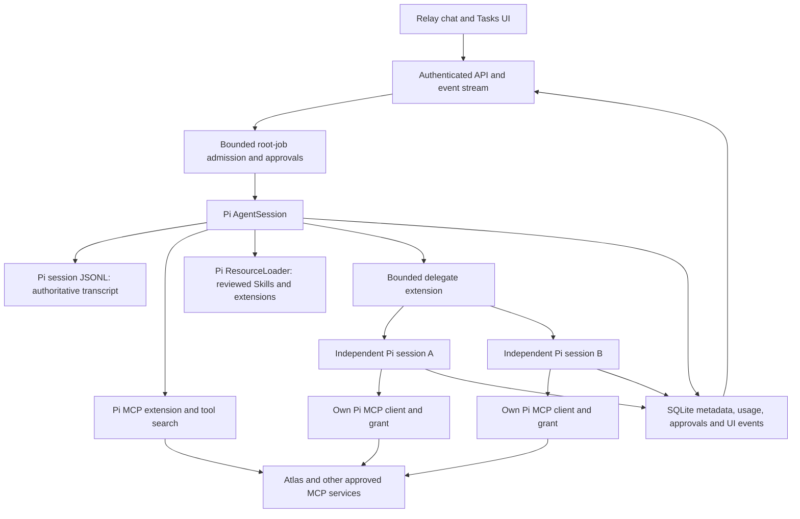

# Architecture

## Ownership

`PiHarness` creates sessions through the public SDK and loads native MCP/tool search plus approved resources. The same creation path serves roots and children. `SessionManager` resumes the persisted conversation; Pi owns the actual messages, tool results, model state and compaction. The authenticated transcript endpoint and Activity trace inspect Pi's stored context directly.

`Engine` admits bounded root requests, serializes turns in a conversation, checks budgets, coordinates approvals and retains restart/reconciliation behavior. It does not execute child jobs or generate synthesis continuations. SQLite contains metadata and read models for UI/recovery, not a second agent transcript supplied to Pi. User-submitted dependent root jobs retain explicit dependency results. Old task schemas remain readable for production history.

`delegate` is a small Pi extension. A call contains `mode: parallel | sequential` and one to four `{prompt, tools}` assignments. Each child gets a distinct identity, conversation and SDK session, the parent's chosen model, its own MCP connection, and only explicitly granted read tools. At most four children are active per parent and eight are admitted per turn. Child runs have a two-minute timeout, also bounded by the parent's deadline and cancellation. No nested spawning is exposed to children. Sequential stages receive the preceding result as untrusted data and stop after a failed stage.

The parent awaits tool results in its existing Pi loop and synthesizes normally. A source-enabled child cannot report successful research without a successful native MCP tool event. Claims in model text do not create tool receipts. Failed children remain inspectable; the parent's final response can accurately explain incomplete work rather than fail a post-hoc English-prompt heuristic.

Root concurrency is configured with `RELAY_MAX_ACTIVE`. Total inference concurrency can include four children per admitted root, so size local inference resources accordingly. Inference continues after a browser disconnect. Server restart interrupts running roots and children and never automatically replays their effects. Queued ordinary root requests may start after recovery. This is bounded background execution, not an autonomous recurring scheduler.

## Permissions and Atlas

One immutable session grant and a call-time hook govern MCP authority. Disabling an integration revokes subsequent calls and redacts results that finish after revocation. Pi discovers schemas and handles transport/results; Relay no longer implements generic MCP schema validation or nested parent-tool brokerage. Tool names use `mcp__provider__tool`.

GitHub's two reviewed writes remain root-only and require an exact configured repository plus explicit approval of the complete argument set. Dispatched writes with unconfirmed results remain uncertain and cannot be silently retried. Atlas development tasks retain their separate, small domain gateway because validating checkout placement, Node capability and named task approval is application policy. Ordinary Atlas reads use native MCP and produce bounded resource observations.

Optional Atlas coding is root-only and explicitly scoped to operator-allowlisted checkouts. It uses Pi native MCP and independent live checkout/Node/Git preflights. A base checkout may only create a fresh atlas/* worktree; edits, staging and commits require one per-turn approval on a verified atlas/* checkout. Push and draft PR creation receive separate exact-operation approvals. Subagents remain read-only, and unknown dispatched writes require reconciliation. See [coding](coding.md).\n\nNo project selector is required. The assistant discovers projects, logical Workspaces, physical checkouts, Nodes and capabilities through Atlas tools. Optional pinned context is a convenience, not permission or proof of current Node state. Observation widgets distinguish discovery from execution.

## Extension boundary

Pi handles resource loading. Reviewed Skills are enabled per installation, loaded through ResourceLoader and read through a bounded reader; they do not grant tools. Operator-installed executable extensions can be supplied through `RELAY_EXTENSION_PATHS` and their allowed tools through `RELAY_EXTENSION_TOOLS`. They execute with server authority and are not a sandbox for untrusted code. Children do not inherit these extensions, Skills, shell access or ambient project configuration.

Conversation continuity uses Pi session persistence and compaction. Automatic memory capture and recurring proactive work are not enabled. See the audit for evaluated memory packages and the controls required before adopting one.
